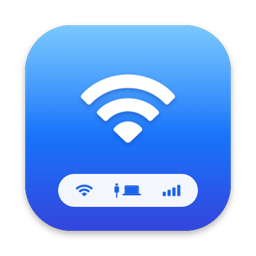
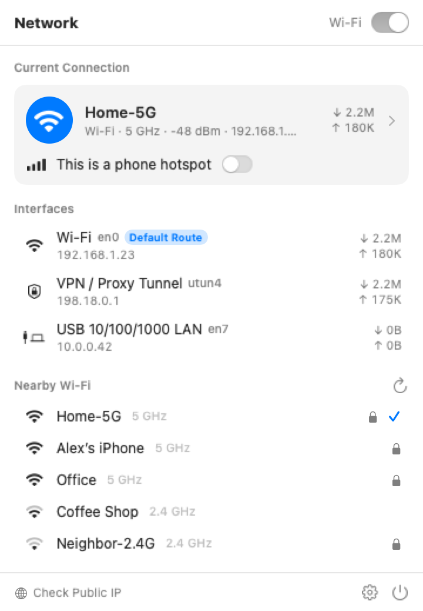
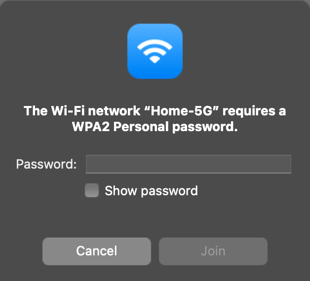
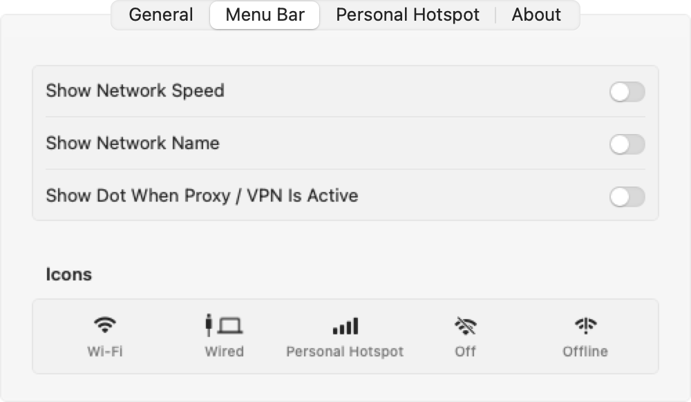

<p align="center">
  
</p>

<h1 align="center">NetBar</h1>

<p align="center">
  A better network menu for macOS: a drop-in replacement for the built-in Wi-Fi icon.<br>
  Wi-Fi, Ethernet, phone hotspots and proxy tunnels, all in one place.
</p>

<p align="center">
  
  &nbsp;&nbsp;
  
</p>

## Features

- **Three icons that follow the link actually carrying your traffic**: Wi-Fi with signal strength, Ethernet (a cable plus a MacBook), and 📶 for phone hotspots.
- **Phone hotspot awareness.** Mark any network as a hotspot, or let NetBar auto-detect one from the iPhone / Android gateway address or a name like “iPhone”, “Galaxy” or “Redmi”.
- **Every detail one click away**: SSID, BSSID, RSSI, noise and SNR, channel / band / width, Wi-Fi generation, link rate, security, IPv4 / IPv6, router, DNS, MAC, MTU, live speed and total traffic. Click any value to copy it.
- **All your interfaces**: Wi-Fi, USB / Thunderbolt Ethernet, bridges, and the `utun` tunnels used by Clash, Surge and VPNs, each tagged *Default Route* or *Physical Link*.
- **Join networks the native way.** A system-style password dialog, with username support for enterprise networks like eduroam.
- **Menu bar extras**: live speed, network name, and a dot while a proxy or VPN is active.
- **Settings window (⌘,)**: language, launch at login, refresh interval and hotspot list.
- **Localized** in English, 简体中文, 繁體中文 and 日本語.
- **Tiny**: a native Swift universal binary of about 1 MB, with no dependencies.

<p align="center">
  
  &nbsp;&nbsp;
  
</p>

## Install

1. Download `NetBar-x.y.z.dmg` from **Releases** and drag NetBar to **Applications**.
2. NetBar is ad-hoc signed, so the first time you open it, right-click it and choose **Open**.
3. Allow **Location** access when asked. macOS requires it to read Wi-Fi names; NetBar never uses your location.
4. Hide the system icon: **System Settings → Control Center → Wi-Fi → Don’t Show in Menu Bar**.

Requires macOS 13 Ventura or later. Runs on Apple silicon and Intel.

## Build from source

```bash
./build.sh            # build/NetBar.app (universal, size-optimized, stripped)
./build.sh install    # build, copy to /Applications and launch
./build.sh dist       # build dist/NetBar-<version>.zip and .dmg
```

The app icon is generated by `swift tools/make_icon.swift`.
